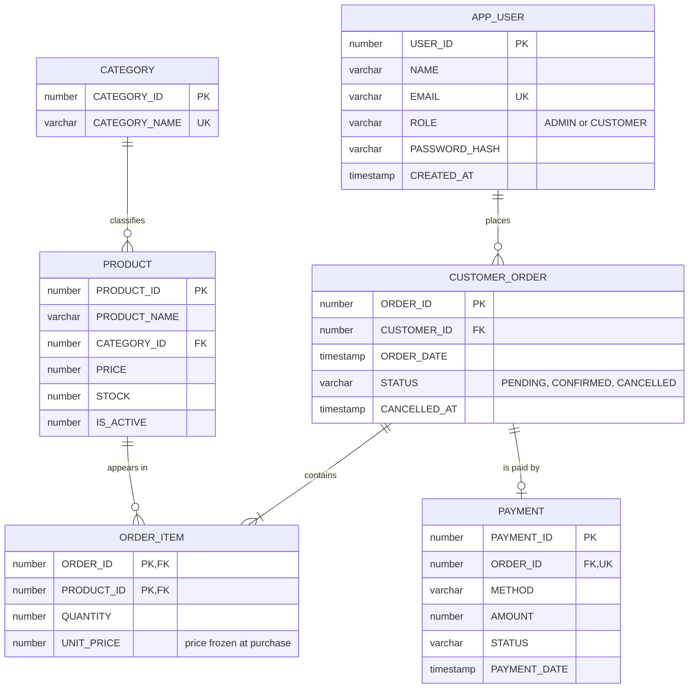

# Phase 1 — Database Design
**E-Commerce Inventory & Order Management System (Java Swing + Oracle)**

Save this file as `docs/PHASE1_DATABASE_DESIGN.md` in your repo.

---

## 1. What the existing project does today

| Area | Current state (from the repo) |
|---|---|
| Storage | Only `ArrayList`s in `Main.java` (`products`, `customers`, `allOrders`). Everything is lost when the app closes. |
| Customers | Register (name + email), login by numeric ID only. IDs come from `nextCustomerId` starting at 1. |
| Admin | Hardcoded: Admin ID `100`, no password. |
| Products | ID is typed by the admin, plus name, category (free text), price, stock. 4 sample products (101–104). |
| Orders | Order IDs start at 1001 (static counter). Statuses: `PENDING`, `CONFIRMED`, `CANCELLED`. `Order` can hold many `OrderItem`s, **but the GUI only lets you order one product at a time**. |
| Payments | `Payment` object, IDs from 5001, methods UPI / Credit Card / Cash on Delivery, status always `SUCCESS` (simulated). |
| Stock | Reduced in Java (`Product.reduceStock`) and restored in Java on cancel. Low stock = `stock <= 5`. |
| Reports | Total sales and order count (CONFIRMED only), low-stock list. |
| Delete product | Removes it from the list (would break order history in a real DB). |
| Build | Plain `.java` files in the repo root (no Maven/Gradle), Java 21 available. `.class` files are committed. |

**Things the database design must fix or support**

1. Data must survive restarts.
2. Orders need many items, with the price frozen at purchase time.
3. Categories are free text, so "Electronics" / "electronics" would be different categories. They need their own table.
4. Customer ID `1…n` will eventually collide with admin ID `100`. Both live in one `APP_USER` table, so the ID ranges must be separated.
5. Deleting a product that was already ordered must not destroy order history.
6. Admin with no password is not real authorization (handled in Phase 7, but the column is designed now).

---

## 2. Changes from the proposed starting design (and why)

| Change | Reason |
|---|---|
| `CUSTOMER_ORDER` has **no stored `TOTAL_AMOUNT`** | The total is derivable (sum of `quantity × unit_price`). Storing it creates a risk of the two disagreeing and breaks 3NF thinking. It will be computed by a PL/SQL function (Phase 4) and a view (Phase 3). `PAYMENT.AMOUNT` stays because it records what was charged at that moment. |
| `PRODUCT.IS_ACTIVE` added | "Delete" in the GUI becomes a **soft delete** (`IS_ACTIVE = 0`). A hard delete is blocked by the foreign key from `ORDER_ITEM`, and we must keep order history. |
| `APP_USER.PASSWORD_HASH` added | Needed for real login in Phase 7. Passwords are stored hashed, never as plain text. |
| `CUSTOMER_ORDER.CANCELLED_AT` added | Records when the cancel happened. Together with the status check, it helps guarantee stock is restored only once. |
| `PRODUCT_ID` is **not** auto-generated | Your GUI asks the admin to type the Product ID, so I keep it as a normal primary key to preserve the GUI. |
| `ORDER_ITEM` primary key is `(ORDER_ID, PRODUCT_ID)` | One order has at most one line per product (the cart will merge quantities). No extra surrogate ID needed. |
| `PAYMENT.ORDER_ID` is `UNIQUE` | Your app creates exactly one payment per order. |

---

## 3. ER Diagram



### Relationships and cardinalities

| Relationship | Cardinality | Meaning |
|---|---|---|
| `APP_USER` – `CUSTOMER_ORDER` | 1 : N | One user places many orders; each order belongs to exactly one user. |
| `CATEGORY` – `PRODUCT` | 1 : N | One category has many products; each product has one category. |
| `CUSTOMER_ORDER` – `ORDER_ITEM` | 1 : N (min 1) | An order has at least one item; each item belongs to one order. |
| `PRODUCT` – `ORDER_ITEM` | 1 : N | A product can appear in many order items. |
| `CUSTOMER_ORDER` – `PRODUCT` | **M : N** | Resolved through `ORDER_ITEM` (the junction table). This is how one order holds many products. |
| `CUSTOMER_ORDER` – `PAYMENT` | 1 : 0..1 | An order has at most one payment record in this app. |

---

## 4. Relational schemas (keys underlined by notes)

```
APP_USER       (USER_ID PK, NAME, EMAIL UNIQUE, ROLE, PASSWORD_HASH, CREATED_AT)
CATEGORY       (CATEGORY_ID PK, CATEGORY_NAME UNIQUE)
PRODUCT        (PRODUCT_ID PK, PRODUCT_NAME, CATEGORY_ID FK→CATEGORY, PRICE, STOCK, IS_ACTIVE)
CUSTOMER_ORDER (ORDER_ID PK, CUSTOMER_ID FK→APP_USER, ORDER_DATE, STATUS, CANCELLED_AT)
ORDER_ITEM     (ORDER_ID PK/FK→CUSTOMER_ORDER, PRODUCT_ID PK/FK→PRODUCT, QUANTITY, UNIT_PRICE)
PAYMENT        (PAYMENT_ID PK, ORDER_ID FK→CUSTOMER_ORDER UNIQUE, METHOD, AMOUNT, STATUS, PAYMENT_DATE)
```

### Integrity constraints (implemented in Phase 2)

| Table | Constraints |
|---|---|
| `APP_USER` | PK on `USER_ID`; `EMAIL` UNIQUE + NOT NULL; `ROLE IN ('ADMIN','CUSTOMER')`; `NAME` NOT NULL and not blank. |
| `CATEGORY` | PK; `CATEGORY_NAME` UNIQUE NOT NULL. |
| `PRODUCT` | PK; `PRICE > 0`; `STOCK >= 0` (stock can never go negative at the database level); `IS_ACTIVE IN (0,1)`; FK to `CATEGORY`; `PRODUCT_NAME` NOT NULL. |
| `CUSTOMER_ORDER` | PK; FK to `APP_USER`; `STATUS IN ('PENDING','CONFIRMED','CANCELLED')`, default `'PENDING'`; `ORDER_DATE` default `SYSTIMESTAMP`. |
| `ORDER_ITEM` | Composite PK; FKs to order and product; `QUANTITY > 0`; `UNIT_PRICE > 0`. |
| `PAYMENT` | PK; `ORDER_ID` UNIQUE; `METHOD IN ('UPI','Credit Card','Cash on Delivery')`; `STATUS IN ('PENDING','SUCCESS','FAILED','REFUNDED')`; `AMOUNT >= 0`. |

**ID ranges (keeps your current numbers):**
- Admin is seeded as `USER_ID = 100`, so your existing "Admin ID 100" login keeps working. The user sequence starts at **101**, so a customer can never collide with the admin.
- Order sequence starts at **1001**, payment sequence starts at **5001** (same as your Java counters).

**Historical prices:** `ORDER_ITEM.UNIT_PRICE` is copied from `PRODUCT.PRICE` at the moment the order is placed. Changing the product price later never changes old orders.

**Payments:** only the method name and simulated status are stored. No card numbers, ever. This is a simulated payment record, not a real gateway.

---

## 5. Functional dependencies

```
APP_USER:        USER_ID → NAME, EMAIL, ROLE, PASSWORD_HASH, CREATED_AT
                 EMAIL   → USER_ID                         (EMAIL is a candidate key)
CATEGORY:        CATEGORY_ID   → CATEGORY_NAME
                 CATEGORY_NAME → CATEGORY_ID               (candidate key)
PRODUCT:         PRODUCT_ID → PRODUCT_NAME, CATEGORY_ID, PRICE, STOCK, IS_ACTIVE
CUSTOMER_ORDER:  ORDER_ID → CUSTOMER_ID, ORDER_DATE, STATUS, CANCELLED_AT
ORDER_ITEM:      (ORDER_ID, PRODUCT_ID) → QUANTITY, UNIT_PRICE
PAYMENT:         PAYMENT_ID → ORDER_ID, METHOD, AMOUNT, STATUS, PAYMENT_DATE
                 ORDER_ID   → PAYMENT_ID                   (because ORDER_ID is UNIQUE here)
```

In every FD above, the left side is a key (primary or candidate). That is exactly the BCNF condition.

---

## 6. Normalization up to 3NF

### Start: one big unnormalized table (like a spreadsheet of orders)

```
ORDERS_FLAT(ORDER_ID, CUSTOMER_ID, CUSTOMER_NAME, EMAIL, ORDER_DATE, STATUS,
            PRODUCT_ID, PRODUCT_NAME, CATEGORY_NAME, PRICE, QUANTITY)
Key: (ORDER_ID, PRODUCT_ID)
```

**Problems (anomalies):** customer name repeats on every order line (update anomaly); you cannot store a product that has never been ordered (insert anomaly); deleting the only order of a product loses the product (delete anomaly).

### 1NF
Every column holds one atomic value, and each order line is its own row. So an order with 3 products is 3 rows, not a list inside one cell. `ORDERS_FLAT` is in 1NF.

### 2NF — remove partial dependencies
The key is `(ORDER_ID, PRODUCT_ID)`, but some columns depend on only part of it:

- `ORDER_ID → CUSTOMER_ID, CUSTOMER_NAME, EMAIL, ORDER_DATE, STATUS`
- `PRODUCT_ID → PRODUCT_NAME, CATEGORY_NAME, PRICE`

Split into:
```
CUSTOMER_ORDER_X(ORDER_ID, CUSTOMER_ID, CUSTOMER_NAME, EMAIL, ORDER_DATE, STATUS)
PRODUCT_X       (PRODUCT_ID, PRODUCT_NAME, CATEGORY_NAME, PRICE)
ORDER_ITEM      (ORDER_ID, PRODUCT_ID, QUANTITY)
```

### 3NF — remove transitive dependencies
- In `CUSTOMER_ORDER_X`: `ORDER_ID → CUSTOMER_ID → CUSTOMER_NAME, EMAIL`. `CUSTOMER_NAME` depends on the order only through the customer. Move customer data to `APP_USER`.
- In `PRODUCT_X`: `PRODUCT_ID → CATEGORY_NAME`. Category is its own entity (it has an identity and can be renamed), so move it to `CATEGORY` and keep `CATEGORY_ID` in `PRODUCT`.

Result = the final 6-table design (with `PAYMENT` as a separate entity). All tables are in 3NF (and in fact BCNF).

### Is `UNIT_PRICE` in `ORDER_ITEM` a violation?
No. `PRODUCT.PRICE` is the **current** price. `ORDER_ITEM.UNIT_PRICE` is a different fact: **the price at the time of that purchase**. It depends on the full key `(ORDER_ID, PRODUCT_ID)`, so it does not break 2NF or 3NF. It is intentional history, not redundancy.

### Lossless-join decomposition
A decomposition of R into R1 and R2 is lossless if `R1 ∩ R2` is a key of R1 or R2. Each split above shares a key column, so joining back gives exactly the original rows with no spurious tuples:

| Split | Common attribute | It is a key of |
|---|---|---|
| `ORDERS_FLAT` → `CUSTOMER_ORDER_X` + `PRODUCT_X` + `ORDER_ITEM` | `ORDER_ID`, `PRODUCT_ID` | `CUSTOMER_ORDER_X` and `PRODUCT_X` respectively |
| `CUSTOMER_ORDER_X` → `CUSTOMER_ORDER` + `APP_USER` | `CUSTOMER_ID` | `APP_USER` |
| `PRODUCT_X` → `PRODUCT` + `CATEGORY` | `CATEGORY_ID` | `CATEGORY` |

All dependencies are also preserved, because each FD ends up fully inside one table.

---

## 7. Plan for later phases (so the design stays consistent)

- **Stock authority (decided in Phase 4):** stock will be reduced in exactly one place, a PL/SQL procedure that locks the product row, so Java will not subtract stock itself. The `STOCK >= 0` CHECK is the last line of defence.
- **Delete product** in the GUI will run a soft delete (`IS_ACTIVE = 0`) and customers will only see active products.
- **GUI change needed in Phase 5:** the Place Order screen needs a small cart so one order can hold several products (your classes already support this, but the screen does not).
- **Registration/login** will gain a password field (Phase 7), and admin login will check the `APP_USER` row with role `ADMIN`.
